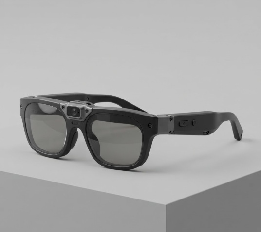
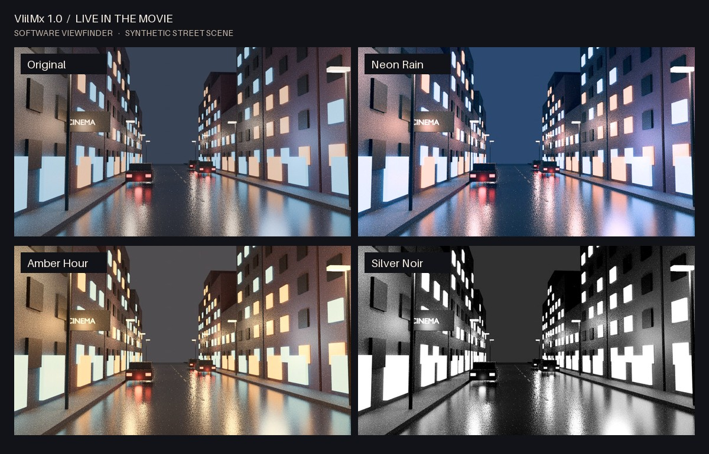

# VIilMx 1.0

**Live in the Movie.**

See an ordinary scene in a different light. VIilMx is a cinematic smart-glasses project built around a forward-facing camera, a head-mounted display design, and a live color-grading pipeline. The software viewfinder lets you try the visual experience on a computer before connecting any wearable hardware.



*Industrial design concept render from the project workspace.*

## See the difference



*Software output on an original synthetic street scene. All panels start from the same frame.*

[Motion preview](assets/demo/live-in-the-movie.gif) · [Hardware design and assembly](docs/hardware.md) · [How the grading works](docs/pipeline.md) · [中文项目说明](docs/README.zh-CN.md)

## Try the software viewfinder

From the repository root, start a local server with Python 3:

```bash
python -m http.server 8000
```

Open [localhost:8000](http://localhost:8000). The synthetic scene loads by default. Try a look, adjust its intensity, then turn the comparison on or off. You can also open a local photo or video, or select **Start camera** and grant browser permission. Your media is processed locally. **Stop camera** releases the live stream.

| Look | Visual treatment |
| --- | --- |
| Neon Rain | Cool shadows and magenta highlights |
| Amber Hour | Warm highlights and restrained saturation |
| Silver Noir | Monochrome with deeper contrast |
| Teal & Copper | Cool shadow tones and warmer highlights |

## What is in this repository

| Path | Contents |
| --- | --- |
| `index.html`, `viewfinder.js` | Browser viewfinder with camera, local media and split comparison |
| `grade.js` | Shared grading engine with luminance analysis, smoothed exposure and tonal color mapping |
| `assets/demo/` | Generated scene, filter outputs, comparison image and animated preview |
| `assets/hardware/` | Owner-provided design, wiring, mechanical and assembly screenshots |
| `docs/hardware.md` | Component list, build sequence and bench verification points |

The visual software is runnable on a desktop browser. Hardware screenshots document the design and build workflow. This publication does not include wearable capture, device firmware, or measured headset performance.

## Rebuild the demo stills

The included `tools/render_street.py` renders the input with Blender 4.x and Cycles. The bundled input can also be used directly. The grading renderer requires Node.js, FFmpeg, and Python with Pillow 10.1+ for the comparison and animation.

```bash
blender -b --python tools/render_street.py
node tools/make_demo.mjs
python tools/assemble_demo.py
```
