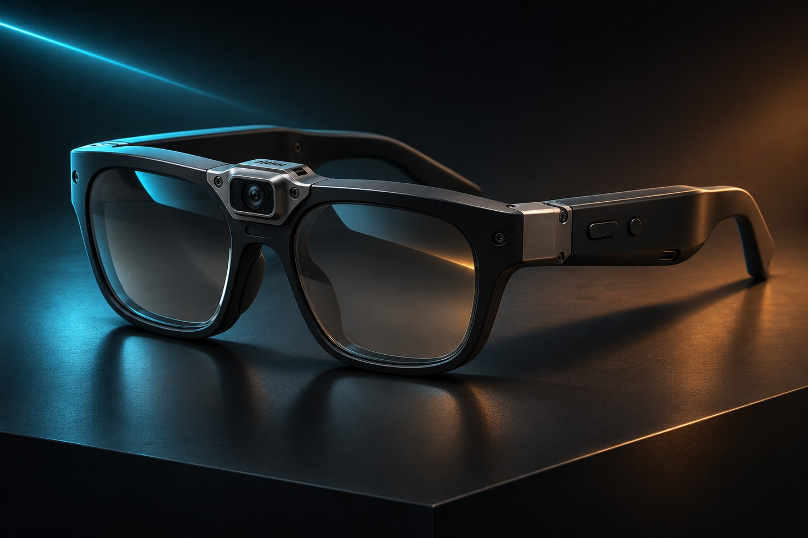
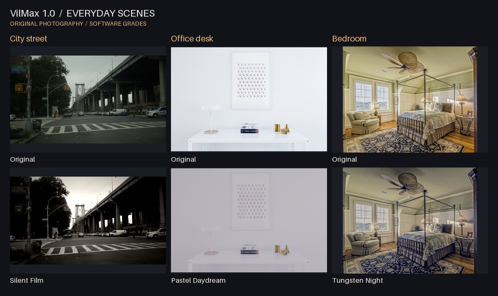

# VIilMx 1.0 · Live in the Movie

VIilMx 是一款电影风格智能眼镜项目。它希望让同一条街、同一个日常场景，随滤镜切换呈现不同的光线和色彩质感。

宣传概念渲染参考了原始镜架和镜桥摄像头设计。[独立图标 SVG](../assets/brand/viilmx-mark.svg) · [原始硬件概念图](../assets/hardware/concept-render.jpg)

城市街景、办公桌和卧室均使用真实照片。每组的原图和效果图采用同一张照片。[完整十种风格对照与照片来源](gallery.md)。[动态预览](../assets/demo/live-in-the-movie.gif)

## 体验软件

在仓库目录运行 `python -m http.server 8000`，然后访问 [localhost:8000](http://localhost:8000)。网页默认载入真实城市街景，也可切换办公桌、卧室或合成街景。你可以切换滤镜、调整强度、打开前后对照，也可以载入自己的照片或视频，或授权浏览器使用摄像头。处理在浏览器本地完成。

## 硬件与算法

[硬件设计记录](hardware.md)整理了镜架布局、接线示意、部件清单和装配步骤。[16 步制作档案](build-log.md)逐项对应打印、接线、上电调试及总装的截图。外观图是设计渲染。网页软件演示与眼镜实拍、硬件实测是不同的展示内容，本仓库目前提供前者及硬件设计截图。

[算法文档](pipeline.md)说明了画面亮度估计、跨帧平滑曝光、对比度和饱和度调整，以及高光和阴影分区调色。
