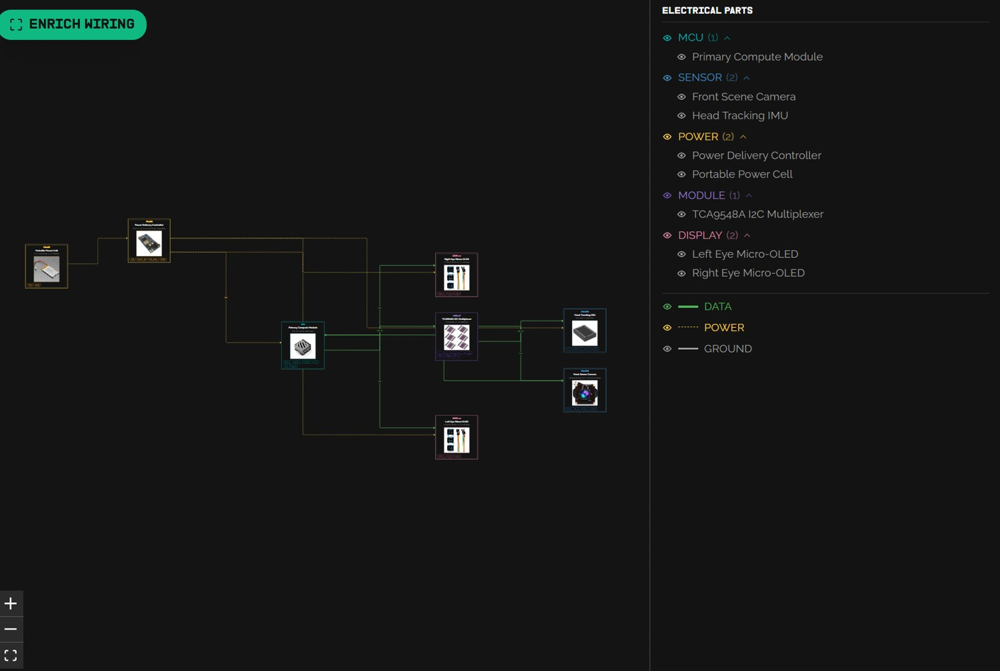
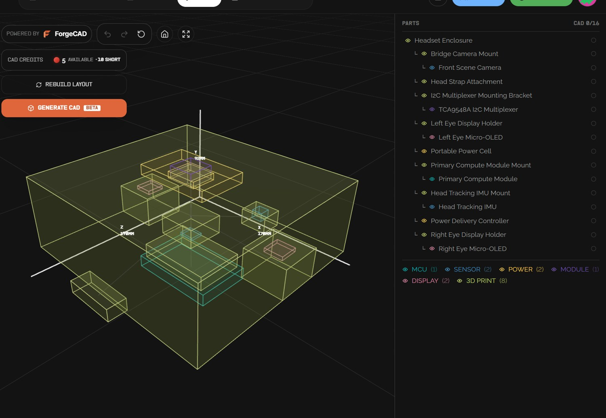

# Hardware build dossier

[Hardware overview and parts](hardware.md) · [Project home](../README.md)

This is a transcription of the supplied design workspace, arranged in build order. The workspace counter in the screenshots reads **0/16 done**. The list below records all 16 documented steps and their visual references. The screenshots show the design and procedure. Photos of fabricated parts, wired assemblies, powered displays and an as-built prototype were not included in the supplied set.

## Design package

| View | What it captures |
| --- | --- |
| [Product concept](../assets/hardware/01-concept.jpg) | Bridge-mounted front camera, eyewear form factor and the design brief for the cinematic viewfinder |
| [Electrical layout](../assets/hardware/02-wiring.jpg) | Eight electrical blocks: compute, camera, IMU, power controller, battery, I²C switch and two displays; data and power routing are sketched separately |
| [Mechanical layout](../assets/hardware/03-layout.jpg) | Enclosure and seven mounting parts: bridge camera mount, strap attachment, I²C bracket, left and right display holders, compute mount and IMU mount. The CAD counter shows 0/16. The placement boxes are layout references. |
| [Tools and assumptions](../assets/hardware/04-fabrication.jpg) | PETG printer and slicer, M2 driver, multimeter, soldering and rework tools, insert tip, wire tools, tweezers, ESD workspace and a configured firmware environment |

  
  

## 1. Fabricate · 3 steps

| Step | Documented work | Reference |
| --- | --- | --- |
| 1.1 | Print the PETG chassis, bridge camera mount, left/right display holders, strap attachment, compute mount and IMU mount. The separate mechanical parts tree also lists the I²C multiplexer bracket. | [Print plan](../assets/hardware/04-fabrication.jpg) |
| 1.2 | Fit M2 brass heat-set inserts into the enclosure and applicable mounts. | [Insert plan](../assets/hardware/05-inserts.jpg) |
| 1.3 | Clean and inspect the printed chassis for debris before fitting electronics. | [Inspection step](../assets/hardware/05-inserts.jpg) |

## 2. Wire · 4 steps

| Step | Documented work | Reference |
| --- | --- | --- |
| 2.1 | Prepare the harness to the power-management unit. | [Harness step](../assets/hardware/05-inserts.jpg) |
| 2.2 | Route power distribution for the two display modules and the sensor subsystem. | [Power distribution](../assets/hardware/06-data-and-power.jpg) |
| 2.3 | Terminate peripheral data connections at the compute module. Camera pixel data, display pixel data and low-speed control require separate interface verification. | [Data connections](../assets/hardware/06-data-and-power.jpg) |
| 2.4 | Inspect the power rails with a multimeter before bring-up. | [Continuity check](../assets/hardware/07-bench-power.jpg) |

## 3. Bring up · 4 steps

| Step | Documented work | Reference |
| --- | --- | --- |
| 3.1 | Run the initial bench power-on check. Record the actual power source and observed results for a reproducible build. | [Power-on checkpoint](../assets/hardware/07-bench-power.jpg) |
| 3.2 | Verify IMU and camera control interfaces and enumerate the expected devices. Record frame capture separately. | [Sensor checks](../assets/hardware/08-bring-up.jpg) |
| 3.3 | Load the appropriate display drivers and confirm output for both panels. | [Display checks](../assets/hardware/08-bring-up.jpg) |
| 3.4 | Calibrate IMU orientation and check camera stream latency. A complete bench record would include the measurement setup and values. | [Calibration and latency](../assets/hardware/08-bring-up.jpg) |

## 4. Assemble · 5 steps

| Step | Documented work | Reference |
| --- | --- | --- |
| 4.1 | Attach the front camera, IMU and compute module to the chassis with their mounts and M2 hardware. | [Module mounting](../assets/hardware/09-module-installation.jpg) |
| 4.2 | Install the left and right displays into their optical holders. | [Display mounting](../assets/hardware/09-module-installation.jpg) |
| 4.3 | Secure the optical holders and other mounts to the main enclosure. | [Mount retention](../assets/hardware/10-final-assembly.jpg) |
| 4.4 | Route the cable bundle and apply strain relief. Check clearance around the enclosure and strap. | [Cable routing](../assets/hardware/10-final-assembly.jpg) |
| 4.5 | Check the final fit and install the head strap. | [Final fit](../assets/hardware/10-final-assembly.jpg) |
