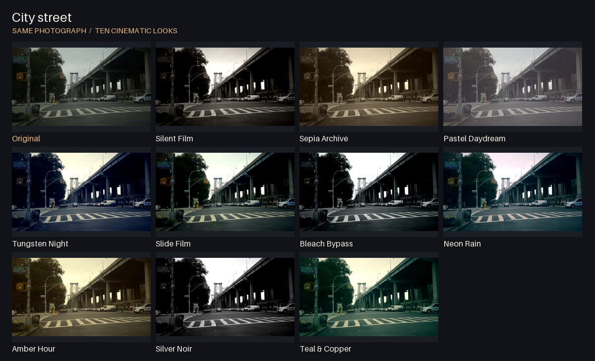
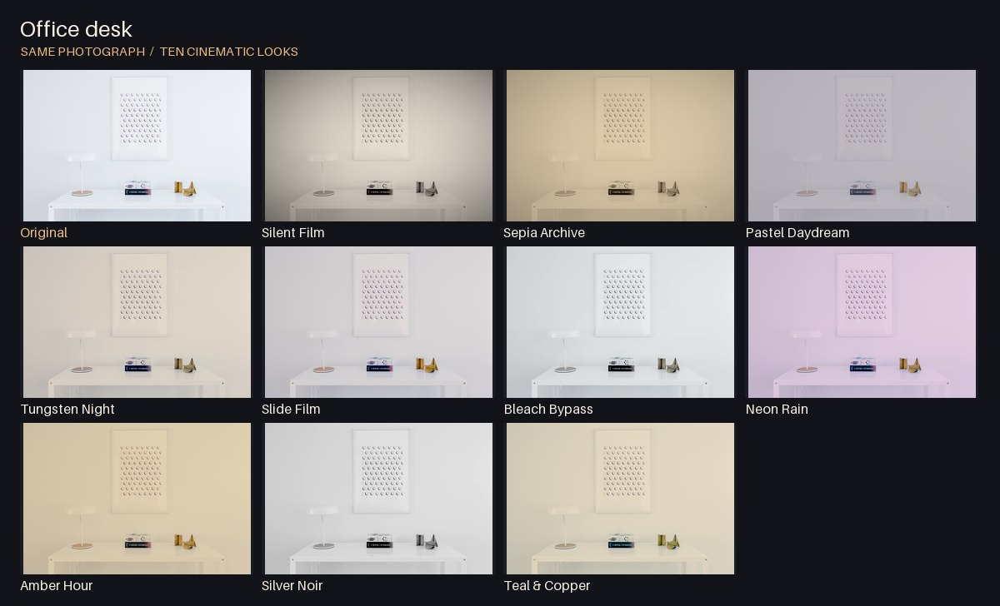
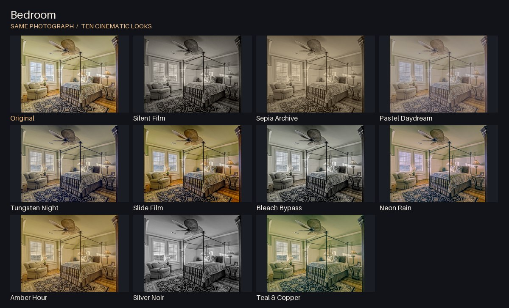

# Everyday scenes

Each scene starts from one real photograph. Every look uses the same framing and the same grading engine as the browser viewfinder. These are software comparisons on public sample photos.

## City street

## Office desk

## Bedroom

## Photo credits

| Scene | Photographer | Source and license |
| --- | --- | --- |
| City street | Alanthebox | [New York City street.JPG](https://commons.wikimedia.org/wiki/File:New_York_City_street.JPG), CC0 1.0 |
| Office desk | Breather | [Minimal desk and painting (Unsplash).jpg](https://commons.wikimedia.org/wiki/File:Minimal_desk_and_painting_(Unsplash).jpg), CC0 1.0 |
| Bedroom | GregoryButler | [Bedroom-TT.jpg](https://commons.wikimedia.org/wiki/File:Bedroom-TT.jpg), CC0 1.0 |

Source photos were resized for the repository. The contact sheets add labels and resize the results for comparison. Rebuild them with `python tools/build_gallery.py` using Node.js and Pillow 10.1+.
